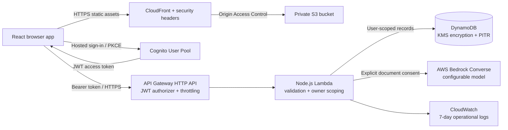

# Folio — your next chapter, organised

A private job application workspace with a responsive UI, status timelines, CV and cover letter tailoring, and a version history for each opportunity. Built with React and Node.js, with serverless AWS and Azure deployment options.


## What you can do

- Create and search applications; record the job description, link, location and private notes.
- Move between **Saved → Applied → Interview → Offer**, or mark Rejected / Withdrawn. Every status change appears in the timeline.
- Paste your CV and an optional cover letter, or upload `.txt`, `.md`, `.pdf` or `.docx` files. PDF/DOCX text is extracted in your browser; scanned PDFs require OCR and are not supported. Tailored documents can be downloaded as cleanly formatted DOCX files.
- Tailor both documents to the selected job using AWS Bedrock or a Microsoft Foundry agent on Azure. The prompt requests natural, specific language, retains factual claims, and flags missing skills instead of inventing them. AI can still make mistakes: review the output before submitting.
- Keep original extracted text alongside every generated version. Download tailored documents as DOCX files. Up to eight versions per job, subject to the 350 KB record limit.
- Export all your data as JSON, or permanently delete an application and its documents from the active database.

## Local development — no AWS account required

Use Node.js **22 or 24** and npm. Start from the existing checkout; cloud tasks are already isolated, so a Git worktree is unnecessary unless explicitly requested.

```sh
npm ci
npm run dev        # terminal 1: local API, port 3001
npm run dev:web    # terminal 2: Vite, port 5173
```

Open the local Vite address reported by the command. The UI identifies the local demo and offers **Explore with example applications**. Demo tailoring uses a deterministic template, **not an AI model**; no external AI request is made and no credentials are needed. Use fictional data in this mode. Local files under `.local/data` persist across restarts and are ignored by Git. The development API uses a fixed identity and binds to loopback; do not expose it or the Vite proxy to the public Internet.

To test real AI locally, configure AWS credentials through your normal SDK profile/identity, then start the API with:

```sh
DEMO_AI=false AWS_REGION=eu-west-2 \
BEDROCK_MODEL_ID=YOUR_ENABLED_MODEL_ID npm run dev
```

The shell's AWS profile is used automatically. `.env.example` documents the available parameters; files named `.env` are **not** automatically loaded. Never commit credentials or real CVs.

## AWS system architecture



[Detailed architecture, data lifecycle and security boundaries](docs/architecture.md).

## Azure deployment

See [infra/azure/README.md](infra/azure/README.md) for the complete Azure setup, costs, prerequisites and live verification checklist. It uses a Free Static Web App, a scale-to-zero Functions API, private LRS Blob Storage, Entra sign-in and Microsoft Foundry Agent Service for tailoring with a low-cost GPT-4.1 nano model. Storage and AI usage are billable.

```powershell
npm ci
az login
$env:AZURE_SUBSCRIPTION_ID = 'YOUR-SUBSCRIPTION-GUID'
az account set --subscription $env:AZURE_SUBSCRIPTION_ID
az bicep install
npm run azure:identity
npm run azure:check
npm run azure:deploy
```

Live deployment requires Azure CLI 2.80.0+, PowerShell 7, model quota and permission to create resources, role assignments and an Entra app registration. Azure commands are separate from the AWS commands below. Preparing the files does not deploy resources or migrate AWS data.

## AWS deployment

AWS infrastructure is defined in [infra/aws/app.mjs](infra/aws/app.mjs) using AWS CDK. Deployment definitions are grouped by cloud provider under `infra/`, with Azure alongside AWS in `infra/azure/`. Run the deployment commands below from the repository root. All AWS values are configurable; the local demo needs none of them. A valid AWS account and enabled Bedrock model are required for a live deployment. Preparing and validating this repository does not deploy AWS resources; live account checks remain necessary.

1. Configure AWS SSO / a deployment role outside the repository. The AWS SDK credential chain is used; do not paste keys into source files. The deployment identity needs CloudFormation, CDK bootstrap, IAM role creation/pass-role, and permissions for the services in the diagram. The runtime Lambda gets a narrower policy.
2. Choose a supported Bedrock model in your region. Complete any required provider use-case/access steps in the Bedrock console, check current pricing, and confirm Converse support. The default model is a configurable example, not a guarantee of availability in every account or region.
3. Export your actual parameters (replace the placeholders):

```sh
export AWS_ACCOUNT_ID=YOUR_12_DIGIT_ACCOUNT_ID
export AWS_REGION=eu-west-2
export AWS_PROFILE=YOUR_PROFILE
export BEDROCK_MODEL_ID=YOUR_ENABLED_MODEL_ID
# Optional: globally unique Cognito domain prefix; default folio-ACCOUNT-REGION
# export COGNITO_DOMAIN_PREFIX=your-unique-folio-login
# Optional budget alert; a notification, NOT a spending limit:
# export BUDGET_EMAIL=you@example.com
# export MONTHLY_BUDGET_USD=10

npm ci
npm run check
npx cdk bootstrap "aws://$AWS_ACCOUNT_ID/$AWS_REGION"
npm run deploy
```

On Windows PowerShell, use the following environment syntax instead of `export`:

```powershell
$env:AWS_ACCOUNT_ID = "YOUR_12_DIGIT_ACCOUNT_ID"
$env:AWS_REGION = "eu-west-2"
$env:AWS_PROFILE = "YOUR_PROFILE"
$env:BEDROCK_MODEL_ID = "YOUR_ENABLED_MODEL_ID"
npm ci
npm run check
npx cdk bootstrap "aws://$($env:AWS_ACCOUNT_ID)/$($env:AWS_REGION)"
npm run deploy
```

`deploy` first validates configuration and uses STS to confirm that your credentials match `AWS_ACCOUNT_ID`. It then runs the application tests, builds the UI, synthesizes and verifies infrastructure, and runs CDK deployment. Review CDK's IAM approval prompt before proceeding. Deployment creates billable resources and publishes the UI plus runtime `/config.json`. Outputs are saved to `cdk.out/outputs.json`; open `AppUrl`, sign up, verify your email and create a record. The static UI has no embedded AWS secrets. Cognito creates the public browser client with authorization-code + PKCE authentication. `npm run deploy:preflight` checks configuration and identity separately without creating resources.

HTML and runtime configuration bypass CloudFront caching; hashed `/assets/*` files use the optimized cache policy. Deployments invalidate existing CDN content. API requests require an access token with the `openid` scope. Expired sessions return to sign-in. API access logs retain request IDs, route names, status, latency and response length for seven days, without document bodies or tokens.

AI requests have a 24-second deadline, inside the gateway's configured 29-second integration timeout ([AWS HTTP API timeout limits](https://docs.aws.amazon.com/apigateway/latest/developerguide/http-api-quotas.html)). A timeout returns HTTP 504 and saves no version; shorten the document or choose a faster model before retrying. Cancellation cannot guarantee that the provider stops processing or charging for work already submitted. For consistently slower models, asynchronous generation with polling is needed before increasing model output limits.

For cross-region Bedrock inference profiles, set `BEDROCK_MODEL_ID` to the **profile ARN**, and `BEDROCK_EXTRA_MODEL_ARNS` to the comma-separated destination foundation-model ARNs allowed by your policy. Cross-region routing affects data residency; choose a regional model if residency is required. The stack deliberately does not grant wildcard model invocation.

### Verify the live deployment

- Open `AppUrl`, register and verify an email. Test sign-out and sign-in.
- Make an unauthenticated request to `ApiUrl/api/jobs`: expect HTTP 401.
- Create an application and tailor a fictional CV with explicit consent; check that Bedrock returns full documents and that both versions remain after reload.
- Create a second account; verify it cannot see or mutate the first account's records.
- Export, delete the application, refresh, and check its documents are gone from the active database.
- Check CloudWatch for invocation errors without enabling request-body or model-invocation payload logging.

These cloud-specific checks remain required after deployment; local tests do not prove Cognito, IAM or Bedrock account access.

### Cost choices

There are no EC2 servers, NAT gateways, load balancers or always-running containers. Lambda, HTTP API and DynamoDB on-demand charge primarily for usage. CloudFront/S3/Cognito may have free allowances or account credits depending on account eligibility and current AWS terms; **free is not guaranteed**. Bedrock inference is usage-billed; start with a small model. DynamoDB point-in-time recovery, storage, logs, API requests and outbound data can add charges. The optional monthly budget alert is not a hard cap; concurrency, API throttles, document-size and version limits help bound abuse but do not eliminate costs. Review AWS's current regional prices before deploying.

### Remove services

```sh
npm run destroy
```

The private web bucket is deleted. **DynamoDB and Cognito are retained** to prevent accidental loss; delete them manually only after exporting records and confirming the data is no longer required. CDK bootstrap resources and backup recovery windows can also incur residual costs. Application deletion removes active records; prior DynamoDB recovery points persist through the configured recovery window (up to 35 days). Account deletion is an administrator operation in this first version; see the data lifecycle guide.

## Validation

```sh
npm test                  # backend behavior + security regression tests
npm run build             # production frontend
npm run infra:synth       # CloudFormation generation + Lambda bundling (no deployment)
npm run check             # the three above + infrastructure security assertions
npx playwright install chromium
npm run test:e2e          # builds and tests production UI with deployed CSP
npm run format:check      # repository formatting
```

If Chromium is preinstalled, run `PLAYWRIGHT_CHROMIUM_EXECUTABLE_PATH=/usr/bin/chromium npm run test:e2e`. Cloud environments may need `npm ci --cache /workspace/.npm-cache` and `PLAYWRIGHT_BROWSERS_PATH=/workspace/.cache/ms-playwright` for writable caches. The suite always starts isolated servers, uses demo AI and local storage, and refuses to reuse existing servers on ports 3001/5173. Stop your development servers first. Test data is fictional and stored under a run-specific `.local/e2e-*` directory. The test deletes its application when successful.

## Repository map

- `src/`: responsive UI, hosted login, workspace, tailoring and version review.
- `server/`: validated API, Lambda adapter, DynamoDB / local persistence, demo generator.
- `infra/aws/`: parameterised AWS CDK infrastructure, deployment configuration and security policy.
- `infra/azure/`: Azure Bicep, Functions adapters, Foundry agent, identity setup, deployment and validation.
- `tests/`: backend and browser tests.
- `docs/`: architecture, security, deployment validation evidence.

## Current limitations

PDF/DOCX uploads are text-extracted in the browser; original formatting is not preserved, and scanned PDFs need OCR, which is not included. DOCX downloads use a clean template. There is no email ingestion, automatic job scraping or automatic employer submission. AI drafts need human review. Production authentication, real model output and deployed service access require live validation on the selected cloud. This is an initial implementation, not a security certification or a statement of regulatory compliance.

[Recorded validation results and remaining cloud checks](docs/validation.md).
