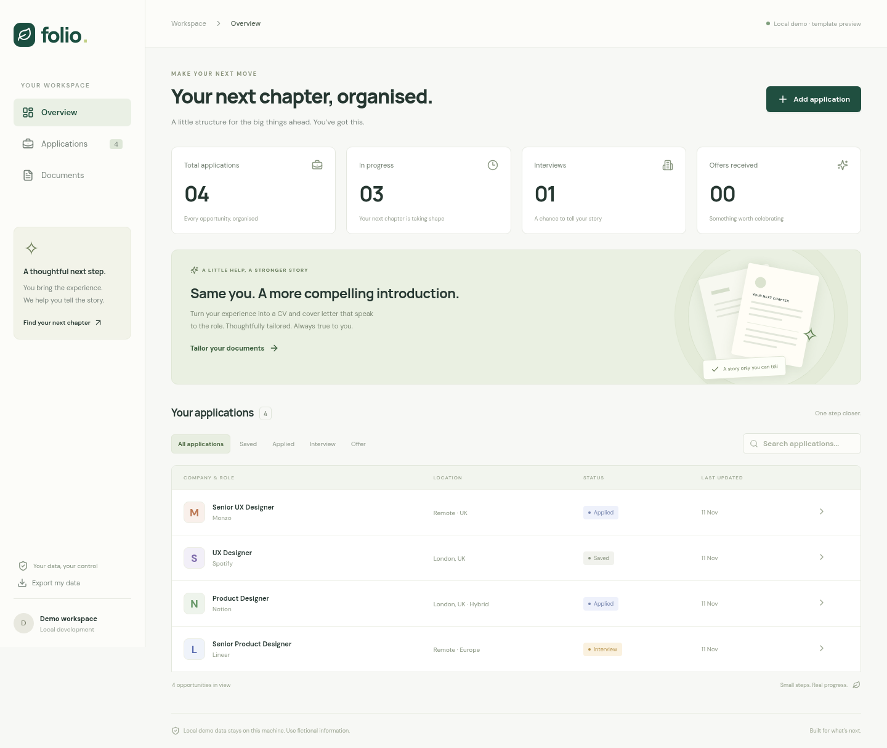
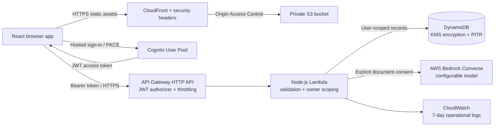

# Folio — your next chapter, organised

A private job application workspace with a responsive UI, status timelines, CV and cover letter tailoring, and a version history for each opportunity. Built with React, Node.js and a serverless AWS backend.



## What you can do

- Create and search applications; record the job description, link, location and private notes.
- Move between **Saved → Applied → Interview → Offer**, or mark Rejected / Withdrawn. Every status change appears in the timeline.
- Paste your CV and an optional cover letter, or upload `.txt` / `.md` files. Copy text from PDF / Word files; binary document parsing is not included.
- Tailor both documents to the selected job using AWS Bedrock. The prompt requests natural, specific language, retains factual claims, and flags missing skills instead of inventing them. AI can still make mistakes: review the output before submitting.
- Keep originals alongside every generated version; download tailored documents as plain text. Up to eight versions per job, subject to the 350 KB record limit.
- Export all your data as JSON, or permanently delete an application and its documents from the active database.

## Local development — no AWS account required

Use Node.js **22 or 24** and npm. Start from the existing checkout; cloud tasks are already isolated, so a Git worktree is unnecessary unless explicitly requested.

```sh
npm ci
npm run dev        # terminal 1: local API, port 3001
npm run dev:web    # terminal 2: Vite, port 5173
```

Open the local Vite address reported by the command. The UI identifies the local demo and offers **Explore with example applications**. Demo tailoring uses a deterministic template, **not an AI model**; no external AI request is made and no credentials are needed. Use fictional data in this mode. Local files under `.local/data` persist across restarts and are ignored by Git. The development API uses a fixed identity and binds to loopback; do not expose it or the Vite proxy to the public Internet.

To test real AI locally, configure AWS credentials through your normal SDK profile/identity, then start the API with:

```sh
DEMO_AI=false AWS_REGION=eu-west-2 \
BEDROCK_MODEL_ID=YOUR_ENABLED_MODEL_ID npm run dev
```

The shell's AWS profile is used automatically. `.env.example` documents the available parameters; files named `.env` are **not** automatically loaded. Never commit credentials or real CVs.

## System architecture



[Detailed architecture, data lifecycle and security boundaries](docs/architecture.md).

## AWS deployment

Infrastructure is defined in [infra/app.mjs](infra/app.mjs) using AWS CDK. All AWS values are configurable; the local demo needs none of them. A valid AWS account and enabled Bedrock model are required for a live deployment. This repository was built and tested locally; **no AWS deployment has been performed** in this environment because no AWS identity is connected.

1. Configure AWS SSO / a deployment role outside the repository. The AWS SDK credential chain is used; do not paste keys into source files. The deployment identity needs CloudFormation, CDK bootstrap, IAM role creation/pass-role, and permissions for the services in the diagram. The runtime Lambda gets a narrower policy.
2. Choose a supported Bedrock model in your region. Complete any required provider use-case/access steps in the Bedrock console, check current pricing, and confirm Converse support. The default model is a configurable example, not a guarantee of availability in every account or region.
3. Export your actual parameters (replace the placeholders):

```sh
export AWS_ACCOUNT_ID=YOUR_12_DIGIT_ACCOUNT_ID
export AWS_REGION=eu-west-2
export AWS_PROFILE=YOUR_PROFILE
export BEDROCK_MODEL_ID=YOUR_ENABLED_MODEL_ID
# Optional: globally unique Cognito domain prefix; default folio-ACCOUNT-REGION
# export COGNITO_DOMAIN_PREFIX=your-unique-folio-login
# Optional budget alert; a notification, NOT a spending limit:
# export BUDGET_EMAIL=you@example.com
# export MONTHLY_BUDGET_USD=10

npm ci
npm run check
npx cdk bootstrap "aws://$AWS_ACCOUNT_ID/$AWS_REGION"
npm run deploy
```

`deploy` builds the UI, provisions services and publishes the UI plus runtime `/config.json`. It creates billable resources and accepts the generated IAM changes. Deployment outputs `AppUrl`; use that HTTPS address, sign up, verify your email and create a record. The static UI has no embedded AWS secrets. Cognito creates the public browser client with authorization-code + PKCE authentication.

For cross-region Bedrock inference profiles, set `BEDROCK_MODEL_ID` to the **profile ARN**, and `BEDROCK_EXTRA_MODEL_ARNS` to the comma-separated destination foundation-model ARNs allowed by your policy. Cross-region routing affects data residency; choose a regional model if residency is required. The stack deliberately does not grant wildcard model invocation.

### Verify the live deployment

- Open `AppUrl`, register and verify an email. Test sign-out and sign-in.
- Make an unauthenticated request to `ApiUrl/api/jobs`: expect HTTP 401.
- Create an application and tailor a fictional CV with explicit consent; check that Bedrock returns full documents and that both versions remain after reload.
- Create a second account; verify it cannot see or mutate the first account's records.
- Export, delete the application, refresh, and check its documents are gone from the active database.
- Check CloudWatch for invocation errors without enabling request-body or model-invocation payload logging.

These cloud-specific checks remain required after deployment; local tests do not prove Cognito, IAM or Bedrock account access.

### Cost choices

There are no EC2 servers, NAT gateways, load balancers or always-running containers. Lambda, HTTP API and DynamoDB on-demand charge primarily for usage. CloudFront/S3/Cognito may have free allowances or account credits depending on account eligibility and current AWS terms; **free is not guaranteed**. Bedrock inference is usage-billed; start with a small model. DynamoDB point-in-time recovery, storage, logs, API requests and outbound data can add charges. The optional monthly budget alert is not a hard cap; concurrency, API throttles, document-size and version limits help bound abuse but do not eliminate costs. Review AWS's current regional prices before deploying.

### Remove services

```sh
npm run destroy
```

The private web bucket is deleted. **DynamoDB and Cognito are retained** to prevent accidental loss; delete them manually only after exporting records and confirming the data is no longer required. CDK bootstrap resources and backup recovery windows can also incur residual costs. Application deletion removes active records; prior DynamoDB recovery points persist through the configured recovery window (up to 35 days). Account deletion is an administrator operation in this first version; see the data lifecycle guide.

## Validation

```sh
npm test                  # backend behavior + security regression tests
npm run build             # production frontend
npm run infra:synth       # CloudFormation generation + Lambda bundling (no deployment)
npm run check             # the three above + infrastructure security assertions
npx playwright install chromium
npm run test:e2e          # browser workflow, starts local servers if needed
```

If Chromium is preinstalled, run `PLAYWRIGHT_CHROMIUM_EXECUTABLE_PATH=/usr/bin/chromium npm run test:e2e`. Cloud environments may need `npm ci --cache /workspace/.npm-cache` and `PLAYWRIGHT_BROWSERS_PATH=/workspace/.cache/ms-playwright` for writable caches. Test data is fictional; with fresh servers the browser suite stores it under a run-specific `.local/e2e-*` directory. The test deletes its application when successful. Use separate servers from your personal workspace.

## Repository map

- `src/`: responsive UI, hosted login, workspace, tailoring and version review.
- `server/`: validated API, Lambda adapter, DynamoDB / local persistence, demo generator.
- `infra/`: parameterised AWS CDK infrastructure.
- `tests/`: backend and browser tests.
- `docs/`: architecture, security, deployment validation evidence.

## Current limitations

Plain-text document import/export only; no PDF/DOCX layout preservation, email ingestion, automatic job scraping or automatic employer submission. Bedrock drafts need human review. Production authentication, real model output and deployed service access require live AWS validation. This is an initial implementation, not a security certification or a statement of regulatory compliance.

[Recorded validation results and remaining cloud checks](docs/validation.md).
