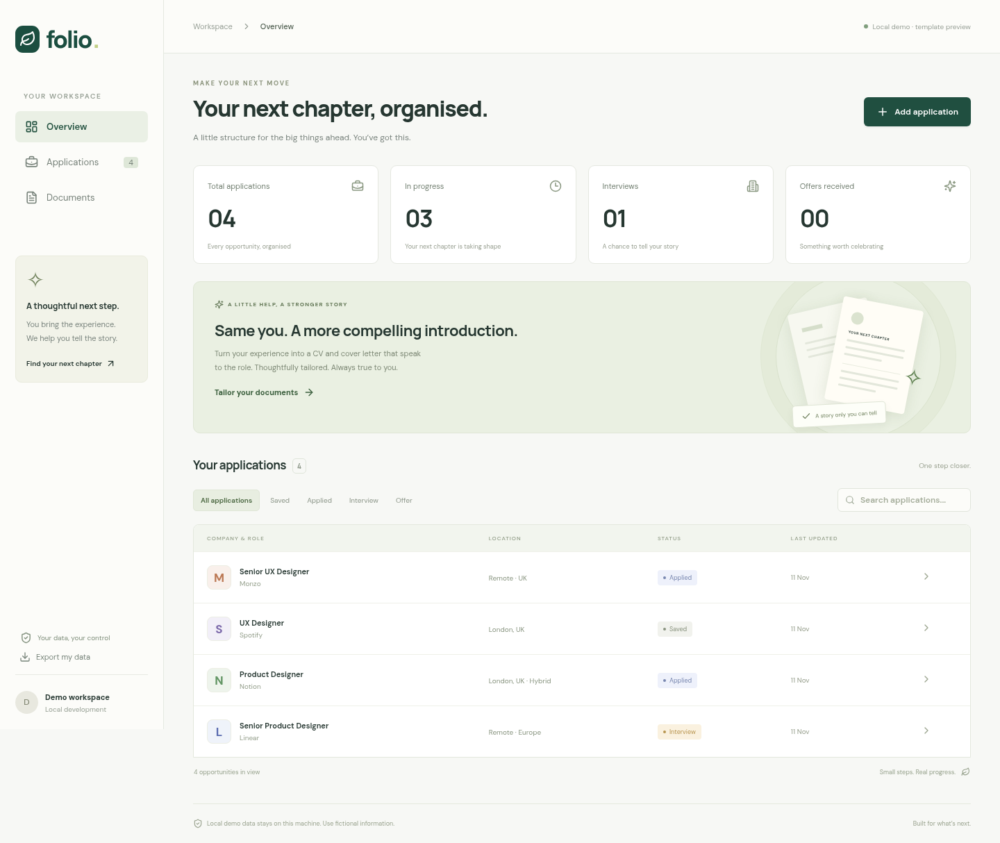
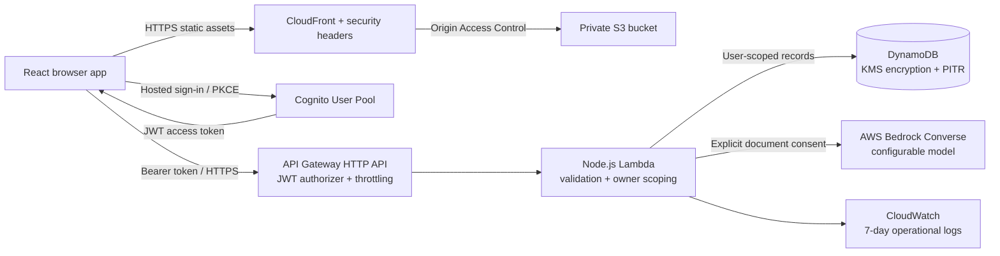

# Folio — your next chapter, organised

A private job application workspace with a responsive UI, status timelines, CV and cover letter tailoring, and a version history for each opportunity. Built with React and Node.js, with serverless AWS, Azure and combined Azure/AWS deployment options.



## What you can do

- Create and search applications; record the job description, link, location and private notes.
- Move between **Saved → Applied → Interview → Offer**, or mark Rejected / Withdrawn. Every status change appears in the timeline.
- Paste your CV and an optional cover letter, or upload `.txt`, `.md`, `.pdf` or `.docx` files. PDF/DOCX text is extracted in your browser; scanned PDFs require OCR and are not supported. Tailored documents can be downloaded as cleanly formatted DOCX files.
- Tailor both documents to the selected job using AWS Bedrock or a Microsoft Foundry agent on Azure. The prompt requests natural, specific language, retains factual claims, and flags missing skills instead of inventing them. AI can still make mistakes: review the output before submitting.
- Keep original extracted text alongside every generated version. Download tailored documents as DOCX files. Up to eight versions per job, subject to the 350 KB record limit.
- Export all your data as JSON, or permanently delete an application and its documents from the active database.

## Local development — no AWS account required

Use Node.js **22 or 24** and npm. Start from the existing checkout; cloud tasks are already isolated, so a Git worktree is unnecessary unless explicitly requested.

```sh
npm ci
npm run dev        # terminal 1: local API, port 3001
npm run dev:web    # terminal 2: Vite, port 5173
```

Open the local Vite address reported by the command. The UI identifies the local demo and offers **Explore with example applications**. Demo tailoring uses a deterministic template, **not an AI model**; no external AI request is made and no credentials are needed. Use fictional data in this mode. Local files under `.local/data` persist across restarts and are ignored by Git. The development API uses a fixed identity and binds to loopback; do not expose it or the Vite proxy to the public Internet.

To test real AI locally, configure AWS credentials through your normal SDK profile/identity, then start the API with:

```sh
DEMO_AI=false AWS_REGION=eu-west-2 \
BEDROCK_MODEL_ID=YOUR_ENABLED_MODEL_ID npm run dev
```

The shell's AWS profile is used automatically. `.env.example` documents the available parameters; files named `.env` are **not** automatically loaded. Never commit credentials or real CVs.

## AWS system architecture



[Detailed architecture, data lifecycle and security boundaries](docs/architecture.md).

## Deployment with Terraform

All three targets use the same configuration format and deployment commands. Copy the AWS, Azure or combo example to `deployment.json`, edit its values, and select the target with `cloud: "aws"`, `cloud: "azure"` or `cloud: "combo"`. Each cloud/environment gets separate Terraform state. Switching targets deploys an independent installation; it does not migrate records or accounts.

```powershell
npm ci
Copy-Item infra/environments/aws.dev.example.json deployment.json
# Or use infra/environments/azure.dev.example.json
# Or use infra/environments/combo.dev.example.json
# Edit the selected account/subscription, tenant, region and model settings.
npm run check
npm run infra:plan
npm run deploy
```

Install Terraform >=1.11,<2 and Node.js 22+. Authenticate outside the configuration using your AWS SSO/profile or Azure CLI. Azure publishing also needs PowerShell 7 and Azure CLI 2.80+. Terraform manages Entra registration and callbacks automatically. `npm run deploy` runs tests/build, prompts through Terraform apply, then publishes code/assets. Cloud services can incur charges; budget alerts are optional and are not spending caps.

See the [shared deployment guide](infra/README.md) for configuration, state backends, environment switching and migration from existing installations. Provider details and live verification: [AWS](infra/aws/README.md), [Azure](infra/azure/README.md), [Azure + AWS](infra/combo/README.md). Combo uses Azure Free Static Web Apps, Functions, Entra and Blob Storage with AWS Bedrock through managed-identity federation. Azure uses Free Static Web Apps, a scale-to-zero Functions API, private LRS blobs and a Foundry prompt agent with GPT-4.1 nano by default; AWS uses CloudFront/S3, Lambda, Cognito, DynamoDB and Bedrock.

## Validation

```sh
npm test                  # backend behavior + security regression tests
npm run build             # production frontend
npm run infra:check       # all three Terraform targets + mocked security tests + runtime packaging
npm run check             # tests, build and Terraform/package checks
npx playwright install chromium
npm run test:e2e          # builds and tests production UI with deployed CSP
npm run format:check      # repository formatting
```

If Chromium is preinstalled, run `PLAYWRIGHT_CHROMIUM_EXECUTABLE_PATH=/usr/bin/chromium npm run test:e2e`. Cloud environments may need `npm ci --cache /workspace/.npm-cache` and `PLAYWRIGHT_BROWSERS_PATH=/workspace/.cache/ms-playwright` for writable caches. The suite always starts isolated servers, uses demo AI and local storage, and refuses to reuse existing servers on ports 3001/5173. Stop your development servers first. Test data is fictional and stored under a run-specific `.local/e2e-*` directory. The test deletes its application when successful.

## Repository map

- `src/`: responsive UI, hosted login, workspace, tailoring and version review.
- `server/`: validated API, Lambda adapter, DynamoDB / local persistence, demo generator.
- `infra/aws/`: AWS Terraform, publishing and security policy.
- `infra/azure/`: Azure Terraform, Functions adapters, Foundry agent and publishing.
- `infra/combo/`: Azure hosting/storage with federated AWS Bedrock inference.
- `tests/`: backend and browser tests.
- `docs/`: architecture, security, deployment validation evidence.

## Current limitations

PDF/DOCX uploads are text-extracted in the browser; original formatting is not preserved, and scanned PDFs need OCR, which is not included. DOCX downloads use a clean template. There is no email ingestion, automatic job scraping or automatic employer submission. AI drafts need human review. Production authentication, real model output and deployed service access require live validation on the selected cloud. This is an initial implementation, not a security certification or a statement of regulatory compliance.

[Recorded validation results and remaining cloud checks](docs/validation.md).
