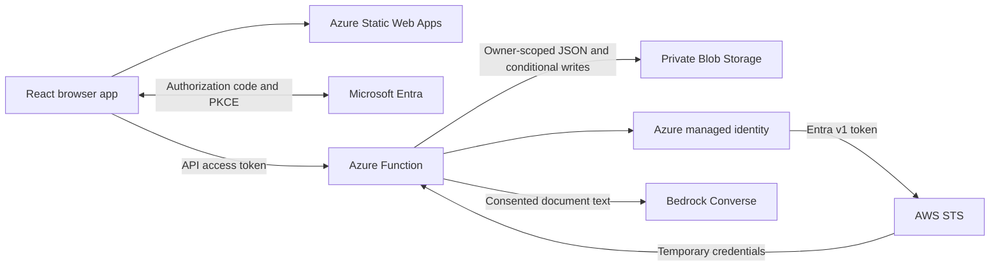

# Current architecture

Reviewed 19 November 2026. Folio is a React frontend and Node.js API with shared application rules and cloud-specific identity, storage and model adapters. The diagram describes the `combo` target; the [deployment guides](../infra/README.md) cover AWS-only and Azure-only alternatives.

## Components

Combo defaults to Azure East US 2 and Bedrock source region eu-west-2. Inference profiles can route to other processing regions. Services communicate over public HTTPS endpoints. The model integration calls Converse directly, without agent tools or retrieval.

## Identity and ownership

Browser sign-in uses OIDC authorization code with PKCE. Tokens are held in session storage; expiry clears the displayed workspace. Session storage remains accessible to browser JavaScript, so CSP, dependency maintenance and output escaping remain necessary.

The Azure HTTP adapter verifies JWT signature, RS256 algorithm, issuer, audience, expiry, tenant, calling client and delegated `access_as_user` scope. It rejects spoofed client-principal headers. CORS restricts browser origins and does not replace authentication.

The verified owner is `tenant ID:object ID`. The Blob adapter hashes it into a prefix; callers cannot select another owner. The shared backend identity can access the account, so isolation depends on the application's ownership checks.

Combo uses a separate Entra registration for AWS federation. Its v1 app-only token is assigned to the Function's managed identity. AWS trust restricts issuer, audience and subject. Temporary STS credentials are cached in memory, refreshed five minutes before expiry, and shared across concurrent refreshes. No long-lived AWS credential is deployed.

AWS-only uses Cognito and API Gateway JWT verification, with the verified subject as owner. Azure-only uses the same Entra and Blob adapters as combo, with a managed identity calling a version-pinned Foundry prompt agent.

## Document lifecycle

1. The browser extracts plain text from TXT, Markdown, PDF or DOCX. Original binary uploads stay in the browser; scanned PDFs require unsupported OCR.
2. A tailoring request supplies the selected job, source documents and explicit consent. Private notes and other applications are excluded from the model prompt.
3. The API checks authentication, ownership, input bounds, version count and storage capacity before inference.
4. The model returns a CV, cover letter, change notes and missing keywords. A source cover letter is optional; both result documents are required.
5. The API validates the complete result and conditionally writes a new version against the original revision. Invalid output, timeouts and revision conflicts save no version.

The prompt treats supplied documents as untrusted data and forbids invented facts. Schema validation checks structure and size, not factual accuracy; users must review drafts.

Bedrock permits at most one corrective call for invalid completed output, with at least five seconds remaining in the original deadline. It does not retry refusals, truncation, provider errors or timeouts. Warnings contain safe categories, field names/codes and provider request IDs, without document text or raw parser errors. Both attempts can incur charges, including when a later write fails.

## API and storage

| Operation                  | Route                                         |
| -------------------------- | --------------------------------------------- |
| List/create applications   | `GET /api/jobs`, `POST /api/jobs`             |
| Edit/delete an application | `PATCH /api/jobs/:id`, `DELETE /api/jobs/:id` |
| Generate a version         | `POST /api/jobs/:id/tailor`                   |
| Export the owner's records | `GET /api/export`                             |

Each application contains metadata, a revision, status history and document versions. Blob creates use `If-None-Match`; updates compare the revision and write with the current ETag. DynamoDB uses conditional writes. Stale updates return 409. The local filesystem store is for single-user development and does not provide the cloud adapters' concurrency guarantees.

List/export reads include complete document histories. Application-level pagination and metadata-only listing are not implemented. Active-record deletion is separate from provider recovery retention; JSON exports are unencrypted files on the user's device.

| Boundary                       | Limit                                            |
| ------------------------------ | ------------------------------------------------ |
| Request JSON                   | 90,000 bytes                                     |
| Stored application             | 350,000 bytes                                    |
| Versions                       | Eight per application, subject to the byte limit |
| Source CV / letter             | 24,000 / 12,000 characters                       |
| Job description                | 18,000 characters; at least 60 for tailoring     |
| Browser file / PDF             | 10 MB / three pages                              |
| Generated CV / letter          | 30,000 / 16,000 characters                       |
| Model output                   | 7,000 tokens                                     |
| Bedrock deadline               | 24 seconds on AWS/local; 55 seconds on combo     |
| Foundry deadline               | 55 seconds                                       |
| Federation token / STS request | Ten seconds each                                 |

Bedrock and STS use one SDK attempt. Lambda has a 30-second timeout behind a 29-second API integration; Azure Functions have a two-minute timeout.

## Design choices and limits

| Choice                                          | Benefit                                                 | Trade-off                                                        |
| ----------------------------------------------- | ------------------------------------------------------- | ---------------------------------------------------------------- |
| Free static hosting and scale-to-zero Functions | Low idle cost                                           | Cold starts and hosting quotas                                   |
| Azure hosting with Bedrock federation           | Existing Azure identity/storage with the selected model | Cross-cloud latency and two permission systems                   |
| One application per blob                        | Simple persistence and conditional writes               | Complete histories are reloaded for lists and updates            |
| Synchronous inference                           | Simple request lifecycle                                | Long-running work cannot survive a lost request as a durable job |
| Shared rules with cloud adapters                | Consistent consent, validation and version behavior     | Each target still requires separate live acceptance tests        |

Azure storage uses private containers, identity-based access, Standard LRS and seven-day blob/container soft deletion; versioning is disabled. AWS uses private S3 hosting and encrypted DynamoDB with point-in-time recovery. Infrastructure deletion guards and storage locks reduce accidental removal; they do not replace backups or application authorization.

AWS operational logs retain seven days. Azure templates do not provision Application Insights or a central log sink. Per-user quotas, durable jobs, account erasure and automated recovery drills remain [future work](future-system-design.md). Optional budget alerts do not cap spending.

See [validation status](validation.md) for completed checks and outstanding authenticated live tests. No production availability or latency objective has been established.

## Implementation references

- [Application routes](../server/application.mjs), [schemas and prompt](../server/core.mjs), [Bedrock adapter](../server/bedrock.mjs).
- [JWT verification](../infra/azure/api/auth.mjs), [Blob adapter](../infra/azure/api/store.mjs), [federated credentials](../infra/combo/api/credentials.mjs).
- [Combo resources](../infra/combo/main.tf), [AWS trust and model policy](../infra/combo/bedrock.tf), [deployment operations](../infra/README.md).
