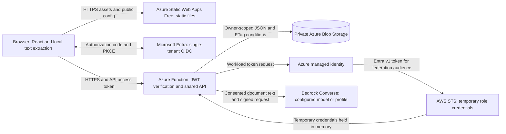
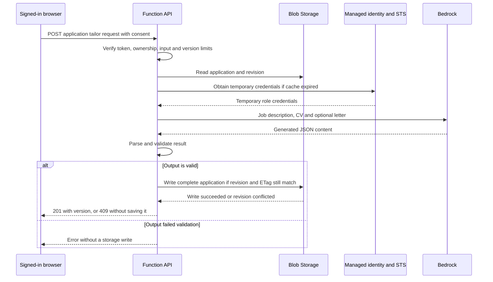

# Current system design

Status: implemented architecture, reviewed 17 November 2026. The current installation is the Azure/AWS `combo` target. AWS-only and Azure-only targets share application logic but have different resource graphs and validation coverage. The [future design](future-system-design.md) is a proposal, not an implemented extension of this system.

## Purpose and constraints

Folio stores private job applications and produces reviewable CV/cover-letter drafts. The present design prioritizes low idle cost, a small operational footprint and explicit user control over model requests. It serves a personal or small-group workload; no production availability or latency SLO has been established.

The application must authenticate every production request, derive ownership from verified identity, prevent lost updates, bound input/history growth, and save a generated version only after valid model output and a successful conditional write. It does not guarantee factual model output or exactly-once model execution.

## Components and trust boundaries

All regional Azure resources, including the resource group, are in East US 2 in the current installation. The Bedrock source region is eu-west-2. A global inference profile can process prompts outside either location; a source endpoint is not a residency guarantee. Network access uses public HTTPS endpoints. The template does not provision private connectivity, a WAF, a queue, an application telemetry backend or a recovery region.

The model integration is application code calling Converse. It does not provision a managed Bedrock Agent, AgentCore runtime, tools, retrieval index or autonomous action loop.

## Authentication and authorization

Browser sign-in uses authorization code with PKCE and a public SPA client. Tokens are stored in browser session storage. Expired sessions clear the displayed workspace and require sign-in. Session storage limits persistence but remains accessible to injected JavaScript; CSP and output escaping do not make the application immune to XSS.

The Function independently verifies the JWT signature, RS256 algorithm, issuer, audience, expiry, tenant, calling client and delegated `access_as_user` scope. It rejects spoofed client-principal headers and does not use ID tokens as API authorization. CORS allows configured frontend origins; it is not an authorization boundary.

The verified owner is `tenant ID:object ID`. The storage adapter hashes it into a blob prefix and obtains application IDs from validated routes. A caller cannot supply a different owner. This is application-enforced isolation: the Function's storage identity can access the whole account, so a compromised backend can cross user boundaries.

Two Entra registrations have different purposes:

| Registration            | Token contract                               | Purpose                                           |
| ----------------------- | -------------------------------------------- | ------------------------------------------------- |
| Browser/API             | v2 delegated access token                    | User sign-in and private API access               |
| AWS federation resource | v1 app-only token; assigned application role | Managed identity exchanges its token with AWS STS |

AWS trust checks the exact tenant issuer, federation audience and managed identity subject. The runtime uses `ManagedIdentityCredential` for this exchange, caches temporary AWS credentials and refreshes five minutes before expiry. Concurrent refreshes share one exchange. No long-lived AWS key or Entra client secret is deployed. Storage uses Azure identity-based access with shared-key authentication disabled.

## Request and document lifecycle

Text extraction and DOCX formatting happen in the browser. Original binary uploads are not stored by this application. Tailoring sends the job's company, role and description, the CV and optional letter; private notes and other applications are excluded. Draft input remains in component memory until submitted. Successful versions retain both source text and generated text.

The prompt treats supplied documents as untrusted data and asks the model to preserve facts. The application validates the returned structure and lengths; it cannot establish that every claim is true. Users must review drafts. Failed output, timeouts and failed writes do not create a version. A model call can still be billed when its result is invalid, discarded after a revision conflict, or abandoned by a client.

## Storage, API and limits

Each application is one JSON blob containing metadata, a revision, stage history and document versions. Creates use `If-None-Match`; updates compare the application revision and use the current blob ETag. Stale updates return HTTP 409. Deletes remove the active blob without an ETag condition. List/export reads each blob under the owner's prefix, including document histories: request count, response size and latency grow with the user's records. Pagination at the application API and metadata-only listing are not implemented.

| Operation   | Route                                         | Result                                        |
| ----------- | --------------------------------------------- | --------------------------------------------- |
| List/create | `GET /api/jobs`, `POST /api/jobs`             | Current owner's applications; new application |
| Edit/delete | `PATCH /api/jobs/:id`, `DELETE /api/jobs/:id` | Conditional edit; active-record deletion      |
| Tailor      | `POST /api/jobs/:id/tailor`                   | Consent required; append a validated version  |
| Export      | `GET /api/export`                             | Current owner's complete records as JSON      |

| Boundary                                | Implemented limit                                        |
| --------------------------------------- | -------------------------------------------------------- |
| Request JSON / Azure streamed request   | 90,000 bytes                                             |
| Stored application                      | 350,000 bytes, including all versions                    |
| Document versions                       | Eight per application; byte limit may be reached earlier |
| Source CV / letter                      | 24,000 / 12,000 characters                               |
| Job description                         | 18,000 characters; at least 60 for tailoring             |
| Browser file selection / PDF pages      | 10 MB / three pages; no OCR                              |
| Generated CV / letter                   | 30,000 / 16,000 characters                               |
| Model output ceiling                    | 7,000 tokens                                             |
| Combo model deadline / Function timeout | 55 seconds / two minutes                                 |
| Federation token request / STS exchange | Ten-second deadline each                                 |

Bedrock and STS use one SDK attempt. GPT reasoning requests omit sampling controls and use low reasoning effort; other configured models retain their adapter settings. These bounds reduce exposure but do not enforce a per-user spending quota or guarantee provider cancellation.

Storage uses Standard LRS, private containers and server-side encryption. Blob/container soft deletion is seven days; blob versioning is disabled. Soft deletion is not complete overwrite recovery, and LRS is not geographic redundancy. JSON exports are unencrypted files on the user's device. There is no automatic retention period for active applications or complete account-erasure workflow. The storage account lock and Terraform destruction guards prevent accidental infrastructure deletion, not malicious authorized writes or application-level deletion.

The default blob service is created by Azure with the storage account. `azapi_update_resource.blobs` updates its retention properties; creating that singleton again would cause an existing-resource error.

## Design decisions

| Decision                                               | Reason                                                                           | Trade-off                                                                            | Impact                                                                                          |
| ------------------------------------------------------ | -------------------------------------------------------------------------------- | ------------------------------------------------------------------------------------ | ----------------------------------------------------------------------------------------------- |
| Free static hosting and scale-to-zero 512 MB Functions | Keep idle cost low                                                               | Cold starts, Free-tier quotas and no frontend SLA                                    | Suitable for a small workspace; not a measured production service tier                          |
| One Azure resource region, East US 2                   | Validated support for both Free Static Web Apps and Flex Consumption             | Less geographic proximity to UK users than the previous backend region               | Small region footprint; frontend and backend service compatibility is checked before deployment |
| Azure hosting with AWS Bedrock                         | Combine Azure's low-cost hosting with the selected model provider                | Cross-cloud latency, egress and two independent permission/control planes            | Azure identity, Entra token issuance, STS and Bedrock must all work for tailoring               |
| Workload federation instead of stored AWS keys         | Avoid long-lived cloud credentials                                               | OIDC registration, subject/audience constraints and token propagation add setup work | Temporary credentials stay server-side; deployments require directory and IAM privileges        |
| Whole application in one blob                          | Simple owner-scoped persistence and conditional updates without a database       | Large list/export responses, repeated document transfer and a shared size cap        | Low infrastructure cost; scaling requires a new metadata/document model                         |
| Synchronous generation                                 | Simple UI and request lifecycle                                                  | No durable jobs, idempotency or retry orchestration                                  | Slow/failed inference returns an error; repeated clicks can create more billable requests       |
| One shared application core with cloud adapters        | Keep validation, consent and version behavior consistent                         | Identity and provider capabilities still differ                                      | Application tests are shared; each cloud needs separate live verification                       |
| Local state by default and explicit target guard       | Simple individual deployment and protection from accidental account/region reuse | Local state can be lost; it is not a distributed lock                                | Backups are essential; team use needs a locked remote backend                                   |
| Cost alerts and bounded requests                       | Give operators visibility and constrain individual operations                    | No hard cap, durable abuse quota or admission control                                | A signed-in user can still accumulate inference cost                                            |

## Supported alternative targets

| Concern      | AWS-only                                                      | Azure-only                                                               |
| ------------ | ------------------------------------------------------------- | ------------------------------------------------------------------------ |
| Static/API   | Private S3 + CloudFront; HTTP API + 512 MB Lambda             | Free Static Web Apps + Flex Functions                                    |
| Login/owner  | Cognito PKCE; verified subject                                | Same Entra user validation as combo                                      |
| Records      | On-demand DynamoDB; conditional writes; PITR                  | Same Blob adapter as combo                                               |
| AI           | Bedrock Converse with Lambda role                             | Version-pinned Foundry prompt agent with managed identity                |
| Deadline     | 24-second model deadline; 29-second gateway; 30-second Lambda | 55-second model deadline; two-minute Function                            |
| Verification | Local/mock coverage; current live record is for combo         | Local/mock coverage; fresh-deployment blob singleton caveat in its guide |

The AWS target's five reserved Lambda invocations and gateway throttling are deployment-wide controls, not user quotas. Its operational/access logs retain seven days. The Azure/combo templates do not provision Application Insights or a central application log sink. No adapter intentionally logs document bodies or authorization tokens; cloud-level logging and administrator access still require review.

## Operational boundaries and current blocker

An infrastructure apply and a public HTTP smoke check do not prove an AI feature is ready. On 17 November 2026, the combo installation was rebuilt, published and checked for anonymous-access rejection, CORS and a clean Terraform plan. After model agreement activation, a bounded GPT-6 Sol test still returned an account-eligibility denial. [AWS documents additional account-level model access requirements](https://docs.aws.amazon.com/bedrock/latest/userguide/model-access.html). See [validation evidence](validation.md) for the exact readiness boundary.

Current gaps include durable job handling, per-user quotas, a model-access canary under the runtime identity, centralized redacted telemetry, automated restore drills, regional recovery and authenticated live end-to-end verification. These gaps drive the [future design](future-system-design.md); they are not implied features of the existing Terraform.

## Implementation references

- [Application rules and API](../server/application.mjs), [schemas and prompt](../server/core.mjs).
- [JWT verification](../infra/azure/api/auth.mjs), [Blob adapter](../infra/azure/api/store.mjs), [federated credentials](../infra/combo/api/credentials.mjs).
- [Combo resources](../infra/combo/main.tf), [AWS trust and model policy](../infra/combo/bedrock.tf), [deployment operations](../infra/README.md).
