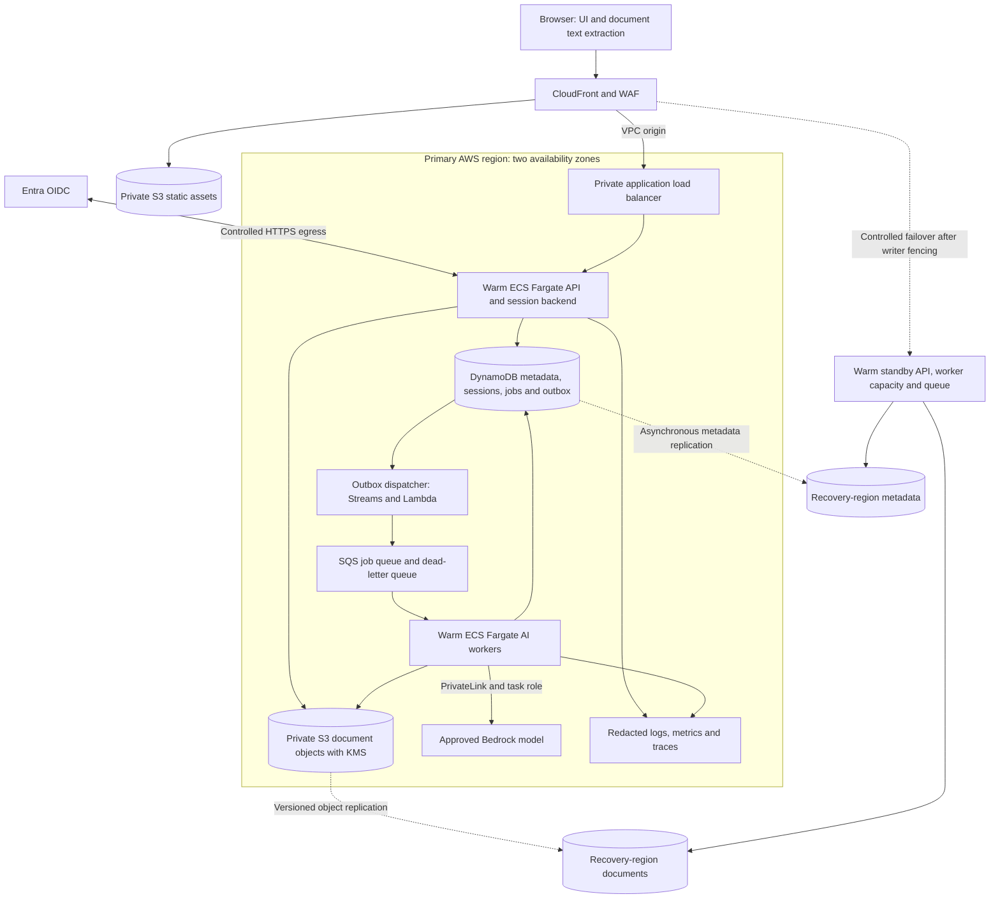
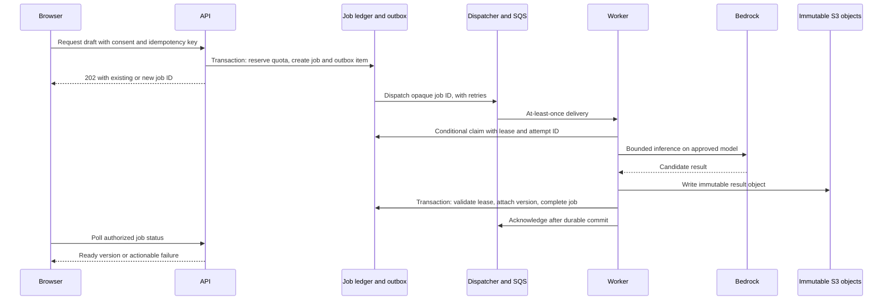

# Future system design

Status: **proposal, not implemented**. Reviewed 17 November 2026. Nothing in this document is deployed by the current Terraform. It describes a production evolution of [the current system](architecture.md), with a reasonable operating budget rather than a free-tier constraint.

## Goals, assumptions and success criteria

Prioritize protection of personal documents, predictable interactive latency, reliable completion of accepted AI work and efficient resource use. Spending more should remove measured constraints, not add infrastructure without a purpose.

Initial sizing assumption: 1,000 monthly active users, 100 daily active users, 10 API requests/second at peak, and 200 AI jobs/day. Start with two API tasks and two modest worker tasks across two availability zones; load-test CPU/memory and concurrency before fixing task sizes. These are planning inputs, not measured current demand. Model quota must cover the tested peak, token volume and failover scenario.

| Proposed objective                                  | Measurement and boundary                                                                                                                                 |
| --------------------------------------------------- | -------------------------------------------------------------------------------------------------------------------------------------------------------- |
| Core API availability >=99.95% monthly              | Valid authenticated CRUD requests; provider/application failures count; report identity-provider outages separately and show their user impact           |
| CRUD p95 <=300 ms, p99 <=800 ms                     | Edge receipt to response, under the tested peak workload; measure user-perceived latency separately by geography                                         |
| Job admission p95 <=500 ms                          | Durable job accepted or explicit rejection returned; not a promise of completed inference                                                                |
| AI completion p95 <=45 s, p99 <=120 s               | Accepted valid jobs during normal operation, including queue wait and commit; count permanent failures separately rather than hiding them in percentiles |
| Regional recovery RTO <=15 minutes, RPO <=5 minutes | Targets conditional on replica readiness and safe writer fencing; verify in drills, not by service configuration alone                                   |
| Data isolation                                      | Automated negative authorization tests across API, jobs, objects, exports and support tools                                                              |

Create separate error budgets for core CRUD and AI completion. A model outage must not make application records unavailable. Reject new AI jobs when quota or queue capacity cannot meet the admission policy; do not accept unlimited work and disguise backlog as reliability.

## Architecture choice

Consolidate application compute, records and model access in AWS. Retain Entra OIDC for existing tenant users initially, avoiding an unnecessary account migration. Identity sign-in remains an external dependency; ordinary record requests no longer need Azure-to-AWS credential exchange.

Choose a primary AWS region close to users **after** validating model eligibility, residency, service availability and quota. For a UK/European workspace, eu-west-2 with eu-west-1 as a recovery candidate is a starting point, not a committed deployment decision. Prefer an approved regional model for European processing. If GPT-6 Sol's global routing is required, obtain explicit processing-policy approval and account access; private networking does not turn global inference into regional-only processing.

CloudFront supports private ALB [VPC origins](https://docs.aws.amazon.com/AmazonCloudFront/latest/DeveloperGuide/private-content-vpc-origins.html). Use an origin security group that admits only the intended CloudFront path; private placement alone does not authorize users. Restrict the static S3 bucket to CloudFront Origin Access Control and enforce HTTPS with managed certificates at the public and origin endpoints. Cache immutable static assets, but disable shared caching for authentication, API, document and job-status responses. Forward the required session cookies and request headers explicitly. Begin with polling for job progress; validate edge/origin support before adding streaming transports.

## Decisions, reasons, trade-offs and impact

| Decision                                                            | Reason                                                                        | Trade-off                                                                      | Expected impact / verification                                                                   |
| ------------------------------------------------------------------- | ----------------------------------------------------------------------------- | ------------------------------------------------------------------------------ | ------------------------------------------------------------------------------------------------ |
| AWS application/data plane near Bedrock                             | Remove cross-cloud request hops and STS federation from ordinary AI execution | Give up Azure's free hosting benefit; migration and AWS concentration risk     | Fewer runtime dependencies; benchmark latency rather than assuming model generation becomes fast |
| Warm Fargate API and workers, minimum two tasks each across two AZs | Predictable startup and independent scaling of CRUD and inference             | Baseline compute, ALB and operational cost                                     | Survive one AZ with spare capacity; load-test under an AZ loss and low traffic                   |
| Browser-facing backend with server-managed sessions                 | Keep OAuth tokens out of browser JavaScript and centralize revocation         | Session persistence, CSRF defenses and confidential-client credential rotation | Lower token exposure; still requires XSS controls and ownership checks                           |
| DynamoDB metadata plus immutable S3 documents                       | Avoid reloading complete CV histories on list operations                      | Cross-store commit/reconciliation logic                                        | Small paginated list responses, independent document growth and bounded object reads             |
| Durable asynchronous AI jobs                                        | Isolate model latency/failure from API requests                               | Job state machine, polling, duplicate-delivery handling and UI changes         | Accepted work survives API restarts; callers can resume progress safely                          |
| Private service access and narrow task roles                        | Reduce network exposure and limit compromise scope                            | Endpoint, routing, DNS and egress-management cost                              | No public tasks/origin or stored AWS keys; verify endpoint policies and resource ownership       |
| Regional primary with warm standby                                  | Recover from a regional outage without permanent dual-write complexity        | Replica lag, failover operations and nonzero RPO                               | Tested recovery instead of an assumed active-active guarantee                                    |
| Model registry with eligibility and quality gates                   | Treat the current account restriction as a release dependency                 | More release checks and evaluation effort                                      | A successful Terraform apply cannot release an uncallable AI feature                             |
| Tenant/user admission quotas and model budgets                      | Protect reliability and control abuse, not just invoices                      | Accounting and rejected requests during overload                               | Bounded queue age, fair access and predictable spend per successful draft                        |
| No default Kubernetes, service mesh, vector database or GPU fleet   | The workload needs CRUD and bounded text generation                           | Less flexibility for unrelated future workloads                                | Lower complexity and fewer idle services; add components only for measured needs                 |

These are design choices, not promises that a managed service solves application correctness or security automatically.

### Alternatives considered

| Alternative                                                       | Why it is not the baseline                                                                                                   | When to reconsider                                                                                     |
| ----------------------------------------------------------------- | ---------------------------------------------------------------------------------------------------------------------------- | ------------------------------------------------------------------------------------------------------ |
| Keep the Azure/AWS split and add private inter-cloud connectivity | Preserves two runtime control planes, routing and operational dependencies                                                   | A contractual Azure requirement outweighs consolidation benefits                                       |
| Lambda with provisioned concurrency for the API                   | Fargate provides a consistent service/connection-pool model alongside long-poll workers; it is not assumed inherently faster | Low intermittent API demand makes provisioned Lambda simpler or cheaper at the measured latency target |
| Aurora PostgreSQL instead of DynamoDB                             | Current access patterns are owner-scoped records/jobs with conditional transitions, not relational reporting                 | Joins, complex search or transactional reporting justify SQL and its operating footprint               |
| Active-active regional writers                                    | Adds conflict/fencing problems across metadata and document storage                                                          | Measured business requirements demand lower regional recovery time and fund the consistency design     |

Revisit the compute choice after benchmarking. A service chosen for predictability should not remain provisioned at an unjustified size simply because a larger budget is available.

## Identity, network and personal-data protection

Use OIDC authorization code with PKCE through the backend. Give the browser an opaque `Secure`, `HttpOnly`, `SameSite=Lax` session cookie, rotate it at login and privilege changes, and validate OAuth state/nonce. Require CSRF tokens and same-origin checks for writes; GET routes must not mutate state. Store sessions server-side with proposed 30-minute idle and eight-hour absolute limits. Enforce expiration when reading a session; eventual TTL cleanup is not the authorization check. Revoke app sessions explicitly when access changes. Discard provider tokens when no longer required, or keep them encrypted server-side only for a documented need. Keep any confidential-client credential in Secrets Manager with rotation.

Use an internal user identifier mapped to verified tenant/object identity. Every data, job and download operation must authorize that owner, including retries, exports and deletion workflows. Separate API, dispatcher and worker task permissions. The API cannot invoke arbitrary models; workers can read only the objects and invoke only the models their role allows. Shared roles do not provide hard per-user isolation: sensitive enterprise tenants may need separate accounts, stores and keys, with that cost accepted explicitly.

Tasks have no public IPs. Use S3/DynamoDB gateway endpoints and interface endpoints for required AWS APIs such as Bedrock Runtime, SQS, ECR, logs and secret/key access. Restrict security groups, endpoint policies and IAM together. [Bedrock PrivateLink](https://docs.aws.amazon.com/bedrock/latest/userguide/vpc-interface-endpoints.html) protects connectivity to the source service endpoint; model processing location still follows the chosen model/profile. Entra login/token/JWKS calls need controlled outbound HTTPS, so include monitored egress through NAT and an allowlisted egress mechanism. NAT alone is not an outbound firewall.

Keep text extraction in the browser. If server-side binary ingestion or OCR is added, isolate it in a sandboxed scanning/extraction pipeline with file-type, decompression, page, memory and execution limits. Do not fetch arbitrary job URLs from the backend. Use customer-managed encryption keys, restricted decrypt grants, private object policies and opaque object names. Neither server-side encryption nor a private subnet prevents an authorized worker or the model provider from seeing submitted plaintext.

Serve document downloads through the authenticated backend initially. Introduce short-lived signed downloads only after accepting their bearer-link exposure and audit implications. Do not share document responses in CDN caches. Preserve CSP, locally hosted assets, dependency scanning and browser output escaping; cookies do not eliminate XSS risk.

Model inputs contain only the selected job/document material with recorded consent. Record the input version/hash, prompt/schema/model versions and consent timestamp, but keep document text out of ordinary logs. Models receive no autonomous tools. Guardrails and injection tests complement schema validation and human review; they do not establish factual correctness or a compliance certification.

## Durable generation and consistency

Use a durable state machine: `accepted → running → succeeded`, with explicit `retry_wait`, `failed`, `cancelled` and ambiguous-attempt states. Scope idempotency keys to the user and request body hash; reusing a key with different input returns a conflict. Store immutable job input references, not a pointer to mutable current CV text.

A DynamoDB transaction writes the job, quota reservation and outbox entry together. A Streams-triggered dispatcher sends the job ID to SQS; a scheduled reconciler recovers undelivered outbox entries after dispatcher/stream outages. Queue messages contain no document text. [SQS can redeliver messages](https://docs.aws.amazon.com/AWSSimpleQueueService/latest/SQSDeveloperGuide/standard-queues-at-least-once-delivery.html), so workers must conditionally acquire a lease, renew it, and commit only under the current attempt/fencing token. A dead-letter queue is investigated, not blindly replayed.

Write the immutable result object before a metadata transaction references it. If the transaction fails, retain or sweep the orphan according to policy. Reconcile incomplete uploads and missing references. Cancellation, application deletion and changed input must be checked again at commit so a late result cannot recreate deleted content or silently overwrite a newer revision. Enforce the version limit and quota accounting in the transaction.

This provides one committed application result per successful job, not exactly-once provider execution or billing. A worker can lose its connection after Bedrock accepted a request. Record that ambiguity; reconcile provider status where supported and require an explicit bounded retry policy otherwise. Do not automatically retry permanent 403 errors. Retry transient failures with jitter, a maximum attempt/time budget and a fresh authorization/lease check.

## Latency and efficiency

Keep list responses metadata-only and paginated; fetch document versions on demand. Preserve search across company, role and location over the user's full metadata set, rather than only the currently loaded page. At the assumed small per-user volume, bounded owner-partition queries can support server-side filtering; add a dedicated search index only when query/volume measurements justify it. Reuse SDK clients and connection pools, and size worker concurrency from measured token throughput, latency and account quota. Scale workers using queue age and available model capacity, rather than CPU alone. Preserve spare API capacity for an AZ loss and set explicit maxima to avoid scale-induced downstream overload.

Use the smallest **approved and evaluated** model that meets factuality, format and quality requirements. Larger-model escalation is a deliberate policy, not a silent fallback. Cache static assets and safe public metadata. Reuse completed jobs only for the same authorized user, exact input/prompt/model versions and compatible retention policy. Do not deduplicate private documents across users. Enable provider prompt caching only for meaningful eligible shared prefixes; do not pad prompts solely to reach a cache threshold.

Keep API and worker scaling independent. Pause admission when model access is unavailable or queue age exceeds the operational threshold; retain CRUD. Provisioned inference or premium tiers are considered only when supported by the selected model and justified by measured latency/utilization. More spending cannot bypass account eligibility or make an unsupported service tier exist.

## Reliability and regional recovery

Run stateless services across two AZs with health checks, graceful draining and bounded timeouts. Keep document versions immutable, enable object versioning and tested backups, and separate backup administration from normal application roles. Replication is not a substitute for backups: it can propagate accidental deletion or corruption.

Use an eventual-consistency DynamoDB replica and versioned S3 replication in the approved recovery region, with a warm standby service, empty regional queues and validated model access there. [DynamoDB MREC replication](https://docs.aws.amazon.com/amazondynamodb/latest/developerguide/V2globaltables_HowItWorks.html) is asynchronous and conditional writes evaluate regional state. It does not safely elect a global writer. Keep one application writer region and explicitly fence old API/workers before promotion. If safe fencing cannot be established, remain read-only rather than permit split-brain writes; the RTO target then yields to data integrity.

A regional queue is not replicated. Recover incomplete jobs from the replicated job ledger only after confirming referenced objects are present, ownership/consent are valid, the prior writer is fenced and ambiguous provider attempts are handled. Cross-service replication is not atomic; measure both metadata and document readiness. Reauthentication after regional failover is acceptable, avoiding unnecessary replication of sensitive session/token material. Exercise failback as carefully as failover.

Require restore and failover drills before advertising RPO/RTO. Zero-loss active-active operation or multi-region strong consistency would need a separate decision, including regional/quorum constraints and the S3 commit problem; it is not a default upgrade purchased by adding replicas.

## Observability, delivery and cost envelope

Emit structured, redacted logs and traces containing request/job IDs, stage, model/prompt versions, latency, token counts, retry reasons and sanitized provider error codes/request IDs. Alert on API failures, authorization anomalies, model 403/429s, queue age, dead letters, missing object references, stale leases, replication lag and cost per successful draft. Keep audit access separate from application support. Proposed defaults are 30-day operational logs and 90-day security audit retention, adjusted to an approved privacy/incident policy; do not log document bodies, tokens or full model responses.

Use separate development/staging/production accounts, protected remote state with locking, least-privilege CI workload identity, immutable image digests, dependency/image scans and software inventories. Deploy backward-compatible API/schema changes through health-checked canaries with rollback. Before an AI release, validate account approval, quota, actual runtime-identity inference and a fictional quality/failure suite; metadata availability fields alone are insufficient. Rollback must not repoint readers to incompatible document/schema versions.

The proposed **planning envelope** is USD 500–1,500/month for primary/warm-standby infrastructure at the assumed small workload, excluding inference, significant internet transfer, organizational identity/support contracts and engineering effort. This is an acceptable-budget assumption, not a provider quote or measured bill. Build a regional estimate with the [AWS Pricing Calculator](https://calculator.aws/) before approval. Warm tasks, ALB, NAT/egress controls, per-AZ interface endpoints, telemetry, replicated data and backups create the fixed floor; right-size them after measurements.

Illustrative model cost: 200 jobs/day × 30 days × (6,000 input tokens × USD 2/million + 2,000 output tokens × USD 10/million) is **USD 192/month**. At 2,000 jobs/day it is USD 1,920/month, before retries and any additional billed reasoning/output usage. These are the documented short-context global Standard GPT-6 Sol rates as reviewed, not a model recommendation or eligibility promise; [check current model pricing](https://docs.aws.amazon.com/bedrock/latest/userguide/model-card-openai-gpt-6-sol.html). Measure actual usage and set admission/tenant budgets. Review the envelope when workload, security requirements or recovery objectives change.

## Retention and migration

Define user-visible retention before launch. A proposed starting policy is active records until user deletion, failed-job payload cleanup within 24 hours, orphan cleanup within 24 hours, and 35-day protected recovery copies. Those are policy proposals requiring implemented deletion jobs and audit evidence, not guarantees supplied by TTL or versioning. Account erasure must cover documents, object versions, job payloads, replicas, exports and expiring recovery copies, with documented legal exceptions. Deletion tombstones must prevent restores/retries from resurrecting erased accounts.

1. Resolve model/account eligibility and approve residency, threat model, cost envelope and measurable objectives first.
2. Build staging with the private network, warm services, session backend and redacted telemetry. Prove tenant/user isolation and quota enforcement.
3. Add the job ledger/outbox/queue and immutable document model. Test duplicate delivery, ambiguous inference, cancellation and commit conflicts.
4. Preserve verified Entra identities during migration. Current blob-owner hashes cannot be reversed; use authenticated export/import or an authorized identity mapping to bind records to the correct user. Check hashes/counts and preserve document/version provenance. Use a per-user write pause and cutover rather than uncoordinated dual writes.
5. Run load, failure, backup restore and regional recovery drills. Verify model access in both candidate regions and test approved fallback behavior.
6. Roll out to a small cohort, compare error/latency/quality/cost metrics, and expand within the error budget. Retain a controlled rollback path while the old data is read-only, then retire it through an approved retention process.

Promotion requires evidence against the targets and threat model. The architectural diagrams and a successful infrastructure apply are not that evidence.
