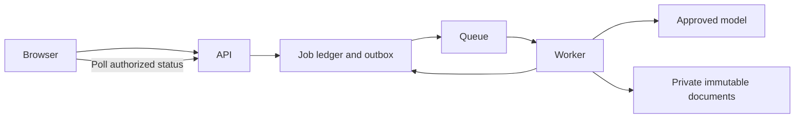

# Future improvements

These are proposals for extending the [current architecture](architecture.md). They are not implemented by the deployment templates. Prioritize changes using measured demand, latency, failure rates and cost.

## Priorities

| Area                   | Improvement                                                                                | Acceptance criterion                                                                             |
| ---------------------- | ------------------------------------------------------------------------------------------ | ------------------------------------------------------------------------------------------------ |
| Runtime verification   | Exercise authentication, isolation and model access through deployed identities            | Fictional end-to-end tests pass for each supported deployment target                             |
| Operations             | Centralize redacted logs and measure request latency, model failures, token usage and cost | Operators can diagnose failures without accessing document text or tokens                        |
| Cost control           | Add per-user admission quotas and concurrency limits                                       | Overload is rejected before inference; budgets account for corrective attempts                   |
| Storage efficiency     | Return paginated application metadata and fetch document versions on demand                | List requests remain small as document histories grow; search still covers all applications      |
| Generation reliability | Move long model requests into durable jobs with resumable status                           | Accepted work survives API restarts; retries and cancellation cannot duplicate saved versions    |
| Recovery and retention | Define retention, account erasure and tested backup/restore procedures                     | Deleted records cannot be recreated by late jobs or restores; recovery is demonstrated in drills |

## Durable AI jobs

Use an authenticated job endpoint that records the selected input version, consent and an owner-scoped idempotency key before returning a job ID. A durable outbox dispatches opaque job IDs to a queue; document text stays in private storage.

Workers conditionally claim jobs with a lease, invoke an approved model within a bounded attempt budget, validate output and commit only while they still own the lease. Recheck ownership, cancellation, application deletion and version limits before committing. Duplicate deliveries must not create duplicate versions.

Write document objects before committing their metadata references, and reconcile orphaned objects and incomplete jobs. A lost provider connection can leave billing or completion uncertain; one committed version does not imply exactly-once inference. Permanent access denials should fail without automatic retries.

## Security and deployment options

Consider a session backend with `Secure`, `HttpOnly` cookies to reduce browser token exposure. This requires server-side session expiry, revocation, CSRF protection and continued ownership checks on every record, job and download.

If cross-cloud dependencies become a measured constraint, evaluate hosting the API, records and workers alongside Bedrock while retaining Entra identities. Compare existing serverless hosting with warm compute before choosing a replacement. Private service access, separate API/worker roles and immutable document storage can then be introduced where their cost and operational benefit are justified.

Keep document bodies and credentials out of telemetry. Record request/job IDs, safe failure codes and prompt/model versions. Define processing regions, retention and support access before adding replicas, OCR or server-side file ingestion.

## Delivery and migration

1. Complete the [outstanding live checks](validation.md#remaining-acceptance-checks) and establish baseline latency, quality and cost measurements.
2. Add telemetry, quotas and storage pagination before increasing capacity.
3. Introduce jobs and immutable document storage in staging. Test duplicate delivery, timeouts, cancellation, revision conflicts and recovery.
4. Migrate records with authenticated export/import or an authorized identity mapping. Existing blob-owner hashes cannot be reversed. Verify counts and document provenance, and pause writes during cutover.
5. Test restore and rollback before retiring the old deployment. Add regional recovery only with an agreed budget, writer-fencing procedure and demonstrated recovery objectives.
